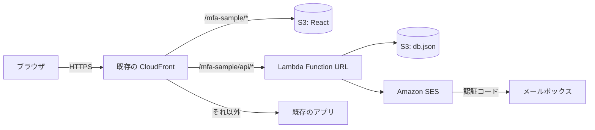

# simple-mfa-sample

ID・パスワードのあとに、メールで届く6桁の認証コード（メールOTP）を入力させる、超シンプルな多要素認証（MFA）のサンプルです。

- 画面は React（Vite）。S3 に置いて、**既存の CloudFront に相乗り**して配信します
- 認証処理は Lambda 1本。Function URL を CloudFront の `<BASE_PATH>/api/*` から呼びます
- DB は使わず、S3 上の JSON ファイル1つにデータを持ちます
- メールは Amazon SES で送ります
- サンプル規模なら、費用はほぼ無料枠に収まります

## 機能

| 機能 | 内容 |
| --- | --- |
| ログイン | ログインID・パスワードを照合し、成功したら MFA メールアドレスへ6桁の認証コードを送る |
| 認証コードの検証 | 有効期限10分、1回限り。1つのコードで試せるのは5回まで |
| 再送 | 60秒の待ち時間つき、1回のログインで5回まで。再送すると古いコードは無効 |
| ロック | パスワードと認証コードの失敗が合計10回でロック。失敗回数は MFA に成功したときだけ消える |
| 残り回数の表示 | 「あと N 回失敗するとロックされます」を表示。存在しないログインIDでも同じ応答 |
| ユーザー登録 | ログインID・パスワード・MFA メールアドレスを登録する画面（管理用キーが必要）。同じIDで登録すると更新になり、ロックも解除される |
| MFA メールアドレスの一意性 | 大文字・小文字を区別せず、全ユーザーで一意 |

## 構成



ブラウザは既存の CloudFront にアクセスします。`/mfa-sample/api/*` は Lambda、`/mfa-sample/*` は S3 に振り分け、それ以外は既存のアプリのままです。Lambda は S3 上の `db.json` を読み書きし、SES で認証コードを送ります。

CloudFront を新しく作らないのは、ディストリビューションの作成が制限されたアカウントでも動かせるようにするためです。CloudFront を新しく作れる環境なら、このサンプル専用のディストリビューションを用意して `DISTRIBUTION_ID` に指定しても同じように動きます。

## ディレクトリ

| パス | 内容 |
| --- | --- |
| `frontend/` | React の画面（ログイン、認証コード入力、ログイン後、ユーザー登録） |
| `backend/` | Lambda の処理。`src/authService.ts` が認証の本体、`src/policy.ts` に回数・時間の決めごと |
| `infra/template.yaml` | CloudFormation テンプレート（S3、Lambda、IAM） |
| `scripts/distribution.mjs` | 既存の CloudFront に、このサンプル用のオリジンと振る舞いを足す・外す |
| `scripts/` | そのほか、デプロイ・初期ユーザー登録・削除のスクリプト |

## 使い方

前提: Node.js 20 以上、AWS CLI v2、SES で検証済みの送信元メールアドレス、相乗りする CloudFront と、その S3 オリジン用の OAC（署名 `always` / `sigv4`）。

```bash
npm install
cp .env.example .env   # 値を埋める
npm test               # 単体テスト
npm run deploy         # テスト → ビルド → CloudFormation → Lambda 差し替え → S3 配置 → CloudFront に相乗り
npm run seed           # .env の SEED_* を初期ユーザーとして登録
```

デプロイが終わると、`deploy-output.json` に `SiteUrl`（`https://<CloudFront>/mfa-sample/index.html`）が出ます。ユーザー登録画面は `SiteUrl#/admin` です。

書き込みに MFA が必須の AWS アカウントでは、`.env` に `MFA_SERIAL` を設定して次のように実行します。

```bash
node scripts/with-mfa.mjs <認証アプリの6桁> deploy seed
```

片付けは `npm run destroy` です。既存の CloudFront からは、このサンプルのオリジンと振る舞いだけを外します（MFA 必須なら `node scripts/with-mfa.mjs <6桁> destroy`）。

## 相乗りするときの注意

- 既存のオリジン・振る舞い・そのほかの設定には触れません。`<STACK_NAME>-site` / `<STACK_NAME>-api` のオリジンと、`<BASE_PATH>/*` / `<BASE_PATH>/api/*` の振る舞いだけを入れ替えます。
- 既存のディストリビューションの `DefaultRootObject` は使えないため、URL は `index.html` まで指定します。
- 既存のディストリビューションに、エラーコードを差し替える設定（例: 403 を別アプリの `index.html` に置き換える）があると、API のエラー応答も差し替えられます。このサンプルの API は 403 を返さないようにしています。
- 既存のディストリビューションに WAF が付いていれば、このサンプルにも同じ WAF が効きます。

## 注意

- SES がサンドボックスのあいだは、送信先のメールアドレスも SES で検証しておく必要があります。
- サンプルなので、本番向けには次の点が足りません。
  - Lambda Function URL は CloudFront を通さずに直接呼べます。本番では CloudFront の OAC で Function URL を保護するか、API Gateway と WAF を使ってください。
  - S3 の JSON 1ファイルは、ユーザー数やアクセスが増えると向きません。DynamoDB などに置き換えてください。
  - 管理用キーと署名用の秘密値は Lambda の環境変数に入っています。本番では Secrets Manager などを使ってください。
  - IP 単位のレート制限はありません。

## ライセンス

MIT
