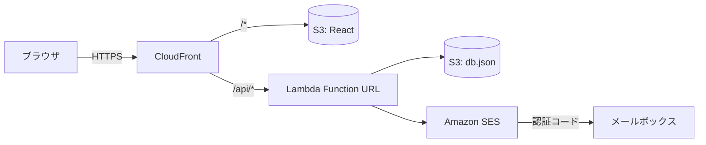

# simple-mfa-sample

ID・パスワードのあとに、メールで届く6桁の認証コード（メールOTP）を入力させる、超シンプルな多要素認証（MFA）のサンプルです。

- 画面は React（Vite）。S3 に置いて CloudFront で配信します
- 認証処理は Lambda 1本。Function URL を CloudFront の `/api/*` から呼びます
- DB は使わず、S3 上の JSON ファイル1つにデータを持ちます
- メールは Amazon SES で送ります
- サンプル規模なら、費用はほぼ無料枠に収まります

## 機能

| 機能 | 内容 |
| --- | --- |
| ログイン | ログインID・パスワードを照合し、成功したら MFA メールアドレスへ6桁の認証コードを送る |
| 認証コードの検証 | 有効期限10分、1回限り。1つのコードで試せるのは5回まで |
| 再送 | 60秒の待ち時間つき、1回のログインで5回まで。再送すると古いコードは無効 |
| ロック | パスワードと認証コードの失敗が合計10回でロック。失敗回数は MFA に成功したときだけ消える |
| 残り回数の表示 | 「あと N 回失敗するとロックされます」を表示。存在しないログインIDでも同じ応答 |
| ユーザー登録 | ログインID・パスワード・MFA メールアドレスを登録する画面（管理用キーが必要）。同じIDで登録すると更新になり、ロックも解除される |
| MFA メールアドレスの一意性 | 大文字・小文字を区別せず、全ユーザーで一意 |

## 構成



ブラウザは CloudFront にだけアクセスします。画面は S3 から、API は Lambda から返ります。Lambda は S3 上の `db.json` を読み書きし、SES で認証コードを送ります。

## ディレクトリ

| パス | 内容 |
| --- | --- |
| `frontend/` | React の画面（ログイン、認証コード入力、ログイン後、ユーザー登録） |
| `backend/` | Lambda の処理。`src/authService.ts` が認証の本体、`src/policy.ts` に回数・時間の決めごと |
| `infra/template.yaml` | CloudFormation テンプレート（S3、CloudFront、Lambda、IAM） |
| `scripts/` | デプロイ・初期ユーザー登録・削除のスクリプト |

## 使い方

前提: Node.js 20 以上、AWS CLI v2、SES で検証済みの送信元メールアドレス。

```bash
npm install
cp .env.example .env   # 値を埋める
npm test               # 単体テスト
npm run deploy         # テスト → ビルド → CloudFormation → Lambda 差し替え → S3 配置
npm run seed           # .env の SEED_* を初期ユーザーとして登録
```

デプロイが終わると、`deploy-output.json` に `SiteUrl` が出ます。そこを開くとログイン画面です。ユーザー登録画面は `SiteUrl/#/admin` です。

書き込みに MFA が必須の AWS アカウントでは、`.env` に `MFA_SERIAL` を設定して次のように実行します。

```bash
node scripts/with-mfa.mjs <認証アプリの6桁> deploy seed
```

片付けは `npm run destroy` です（MFA 必須なら `node scripts/with-mfa.mjs <6桁> destroy`）。

## 注意

- SES がサンドボックスのあいだは、送信先のメールアドレスも SES で検証しておく必要があります。
- サンプルなので、本番向けには次の点が足りません。
  - Lambda Function URL は CloudFront を通さずに直接呼べます。本番では CloudFront の OAC で Function URL を保護するか、API Gateway と WAF を使ってください。
  - S3 の JSON 1ファイルは、ユーザー数やアクセスが増えると向きません。DynamoDB などに置き換えてください。
  - 管理用キーと署名用の秘密値は Lambda の環境変数に入っています。本番では Secrets Manager などを使ってください。
  - IP 単位のレート制限はありません。

## ライセンス

MIT
