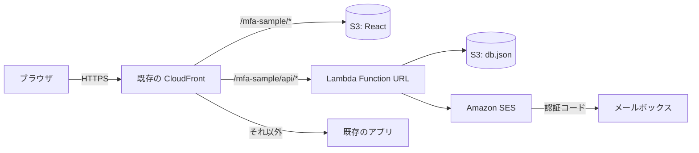
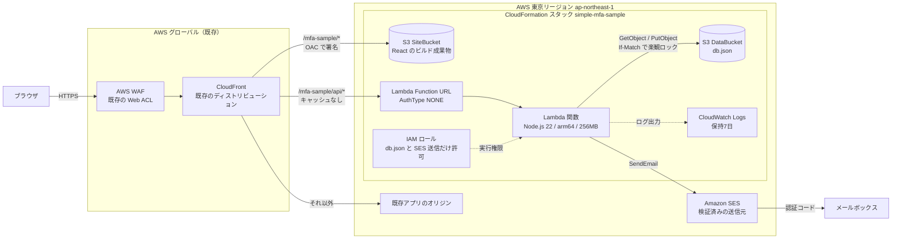
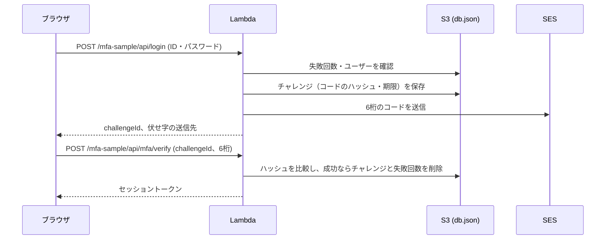

# はじめに

「ID・パスワードのあとに、メールで届く6桁のコードを入れさせたい」。

多要素認証（MFA）の話になると、Cognito や IDaaS の導入から考えがちです。でも「まず動きを触って、仕様を詰めたい」段階なら、もっと小さく作れます。

この記事では、次の構成で **メールOTP方式の MFA** を動かします。

- 画面: React（Vite）を S3 に置き、既存の CloudFront に相乗りして配信
- 認証処理: Lambda 1本（Function URL）
- データ: DB を使わず、S3 上の JSON ファイル1つ
- メール送信: Amazon SES

ロック、再送制御、ユーザー登録画面まで入れても、コードは小さく収まります。

コード一式はこちらです。

https://github.com/Tom-Panasonic/simple-mfa-sample

# 作ったもの

画面は4つです。

| 画面 | 内容 |
| --- | --- |
| ログイン | ログインID・パスワードを入力 |
| 認証コード入力 | メールで届いた6桁を入力。60秒ごとに再送できる |
| ログイン後 | ログインIDとセッションの有効期限を表示 |
| ユーザー登録 | ログインID・パスワード・MFAメールアドレスを登録（管理用キーが必要） |

認証の決めごとは、次のとおりにしました。

| 項目 | 仕様 |
| --- | --- |
| 認証コード | 6桁の数字。有効期限10分。1回限り |
| 1つのコードで試せる回数 | 5回。超えたら ID・パスワードからやり直し |
| 再送 | 60秒の待ち時間つき。1回のログインで5回まで。再送すると古いコードは無効 |
| ロック | パスワードと認証コードの失敗が合計10回でロック |
| 失敗回数のリセット | パスワードが合っただけでは消さない。**MFA に成功したときだけ**消す |
| 残り回数の表示 | 「あと N 回失敗するとアカウントがロックされます」 |
| MFAメールアドレス | 大文字・小文字を区別せず、全ユーザーで一意 |

# 構成



まずは通信の流れだけを示します。リソース単位の構成図は、このあとの「インフラ構成図」に載せています。

ブラウザがアクセスするのは CloudFront だけです。`/mfa-sample/api/*` は Lambda の Function URL に、`/mfa-sample/*` は S3 に振り分けます。画面と API が同じオリジンになるので、CORS の設定がいりません。

CloudFront は新しく作らず、**既存のディストリビューションに相乗り**させました。理由は「ハマったところ」に書きます。

## インフラ構成図



ブラウザからの通信は、既存の WAF と CloudFront を通ります。CloudFront は `/mfa-sample/*` をこのサンプルの S3（SiteBucket）へ、`/mfa-sample/api/*` を Lambda の Function URL へ振り分けます。それ以外のパスは既存アプリのままです。Lambda は DataBucket の `db.json` を読み書きし、SES で認証コードのメールを送ります。

作るものと既存のものは、次のように分かれます。

| リソース | 作り方 | 役割 |
| --- | --- | --- |
| S3 SiteBucket | CloudFormation | React のビルド成果物。非公開で、相乗り先の CloudFront からだけ読める |
| S3 DataBucket | CloudFormation | `db.json`（ユーザー、失敗回数、認証コードのハッシュ）。Lambda からだけ読み書きする |
| Lambda 関数・Function URL | CloudFormation（コードはデプロイ時に差し替え） | ログイン、認証コードの検証・再送、ユーザー登録 |
| IAM ロール | CloudFormation | `db.json` の読み書き、SES での送信（送信元アドレスを限定）、ログ出力だけを許可 |
| CloudWatch Logs | CloudFormation | Lambda のログ。7日で消える |
| CloudFront のオリジン2つ・振る舞い2つ | デプロイスクリプト（`update-distribution`） | 既存のディストリビューションに足す。片付け時は自分の分だけ外す |
| CloudFront・WAF・OAC | 既存のものを使う | OAC は S3 用の汎用設定なので、そのまま使い回す |
| SES の送信元 | 既存のものを使う | 検証済みのメールアドレス |

## 費用

サンプル規模なら、ほぼ無料枠に収まります。

| サービス | 使い方 | 費用の目安 |
| --- | --- | --- |
| S3 | 画面のファイルと db.json | ほぼ0円 |
| CloudFront | 配信と HTTPS（既存のディストリビューションに相乗り） | 無料枠（月1TB）に収まる |
| Lambda | 認証処理（arm64・256MB） | 無料枠に収まる |
| SES | 認証コードのメール | 1,000通で約0.1ドル |

API Gateway・DynamoDB・Secrets Manager を使わないのも、安くするためです（本番での注意点は最後に書きます）。

# 「React だけ」では作れない理由

最初は「React だけで完結できないか」と考えました。でも、MFA ではそれは成り立ちません。

- 認証コードをブラウザで作って比べると、開発者ツールから正解が見えてしまう
- メールを送る API キーをブラウザに置くことになる
- パスワードの照合もブラウザでやると、照合を飛ばす改変ができてしまう

なので、**秘密を扱う処理だけは Lambda に置く**ことにしました。Lambda 1本なら、サーバーを持つ手間はほとんどありません。

# 処理の流れ



パスワードが合うと、Lambda は「チャレンジ」を作ります。チャレンジには、認証コードのハッシュ、有効期限、送信回数、試行回数を持たせます。ブラウザに返すのは `challengeId` と伏せ字の送信先（`t***@example.com`）だけです。

# 実装のポイント

## 1. DB の代わりに S3 の JSON 1ファイル、ただし上書き事故は防ぐ

データは `db.json` 1つです。

```json
{
  "users": { "<loginId>": { "passwordHash": "...", "mfaEmail": "...", "updatedAt": 0 } },
  "failures": { "<loginId>": { "count": 3 } },
  "challenges": { "<challengeId>": { "loginId": "...", "codeHash": "...", "expiresAt": 0, "lastSentAt": 0, "sendCount": 1, "attempts": 0 } }
}
```

ファイル1つだと、Lambda が同時に2つ動いたときに、後から書いた方が先の更新を消してしまいます。そこで、S3 の**条件付き書き込み**（`If-Match`）で楽観ロックをかけました。

```ts
async update<T>(mutate: (db: Db) => T): Promise<T> {
  for (let attempt = 0; attempt < MAX_RETRIES; attempt++) {
    const { db, etag } = await this.load();
    const result = mutate(db);
    try {
      await this.client.send(
        new PutObjectCommand({
          Bucket: this.bucket,
          Key: this.key,
          Body: JSON.stringify(db),
          // 読んだときと ETag が同じときだけ書く。初回はファイルが無いときだけ書く
          ...(etag === undefined ? { IfNoneMatch: '*' } : { IfMatch: etag }),
        }),
      );
      return result;
    } catch (error) {
      if (isWriteConflict(error)) continue; // 412 / 409 なら読み直してやり直す
      throw error;
    }
  }
  throw new Error('db.json の更新が競合しました');
}
```

読んだあとに誰かが書き換えていたら 412 が返ってくるので、読み直してやり直します。これで、「失敗回数の加算が消える」といった事故を防げます。

## 2. 認証コードは平文で保存しない

認証コードは、`challengeId` と結びつけた HMAC で保存します。比較は定数時間で行います。

```ts
export function hashCode(secret: string, challengeId: string, code: string): string {
  return createHmac('sha256', secret).update(`${challengeId}:${code}`).digest('base64url');
}
```

コードは `crypto.randomInt` で作ります。`Math.random` は使いません。

パスワードは Node 標準の `scrypt` でハッシュ化しています。追加のライブラリはいりません。

## 3. 失敗回数は「MFA に成功したとき」だけ消す

ここが一番大事なところです。

よくある実装では、**パスワードが合った時点で失敗回数を消します**。でも MFA を足したあとでそれをやると、パスワードを知っている攻撃者は次を延々と繰り返せます。

1. 正しいパスワードを入れる（失敗回数が0に戻る）
2. 認証コードを何回か当てずっぽうで入れる
3. 1に戻る

これでは、6桁のコードでも総当たりされます。なので、失敗回数はパスワードと認証コードで共通にして、**消すのは MFA に成功したときだけ**にしました。

```ts
if (safeEqual(challenge.codeHash, hashCode(this.appSecret, challengeId, code))) {
  delete db.challenges[challengeId]; // コードは1回限り
  delete db.failures[loginId];       // ここで初めて失敗回数を消す
  return { kind: 'success', loginId, now } as const;
}
```

## 4. 再送には待ち時間と回数の上限を付ける

再送ボタンに制限がないと、メール爆撃（同じ人に大量のメールを送りつける攻撃）に使われます。SES の送信上限にも引っかかります。

- 再送したら、古いコードは無効にする
- 次の再送まで60秒待たせる（画面に残り秒数を出す）
- 1回のログインで再送は5回まで

待ち時間はサーバー側で判定します。画面のカウントダウンは、あくまで表示用です。

## 5. 存在しないログインIDでも同じ応答を返す

「ログインIDが違います」と「パスワードが違います」を分けると、ログインIDが存在するかを第三者に知られてしまいます。このサンプルでは次のようにしました。

- メッセージは「ログインIDまたはパスワードが正しくありません」で統一する
- 存在しないログインIDでも失敗回数を数え、同じ「残り N 回」を返す
- 存在しないログインIDでもダミーのハッシュで scrypt を回し、応答時間をそろえる

## 6. 既存の CloudFront に「相乗り」する

CloudFront を新しく作れない（作りたくない）環境向けに、既存のディストリビューションへ振る舞いを2つ足す方式にしました。既存の設定には触れず、自分の分だけを入れ替えます。

| 振る舞い（上から評価） | オリジン | キャッシュ |
| --- | --- | --- |
| `/mfa-sample/api/*` | Lambda Function URL | Managed-CachingDisabled |
| `/mfa-sample/*` | このサンプルの S3 バケット | Managed-CachingOptimized |
| 既存の振る舞い・デフォルト | 既存のまま | 既存のまま |

既存のディストリビューションは CloudFormation のスタック外なので、`get-distribution-config` で取ってきて、自分のオリジンと振る舞いだけを差し込んで `update-distribution` で戻します。何度実行しても同じ結果になるように、Id とパスパターンで「自分の分を消してから足す」形にしています。

```js
/** 自分のオリジン・振る舞いを取り除いた設定を返す（既存の分はそのまま） */
function withoutOwn(config, n) {
  const origins = config.Origins.Items.filter(origin => origin.Id !== n.siteOriginId && origin.Id !== n.apiOriginId);
  const behaviors = (config.CacheBehaviors.Items ?? []).filter(b => b.PathPattern !== n.sitePattern && b.PathPattern !== n.apiPattern);
  return { ...config, Origins: { Quantity: origins.length, Items: origins }, CacheBehaviors: /* 省略 */ };
}
```

相乗りで気をつけたことは3つです。

- **OAC は使い回せる**: S3 オリジン用の OAC（Origin Access Control）は、バケットごとに作る必要はありません。既存の OAC をこのサンプルのバケットにも指定し、バケットポリシーで「このディストリビューションからの読み取りだけ許可」にしました。
- **エラーページの差し替えに注意**: 相乗り先に「403 を `/index.html` に差し替える」設定（SPA でよくある設定）がありました。この設定はすべての振る舞いに効くので、API が 403 を返すと、別アプリの HTML が 200 で返ってきます。このサンプルの API は 403 を使わず、401 で返すようにしました。
- **index.html まで指定する**: `DefaultRootObject` はディストリビューションのルートにしか効きません。URL は `/mfa-sample/index.html` にしています。

## 7. CloudFront から Lambda Function URL へ流すときの注意

`/mfa-sample/api/*` を Function URL に流すとき、オリジンリクエストポリシーは **Managed-AllViewerExceptHostHeader** にします。`Host` ヘッダーまで転送すると、Function URL がリクエストを受け付けません。

```js
const apiBehavior = behavior(n.apiPattern, n.apiOriginId, {
  ViewerProtocolPolicy: 'https-only',
  CachePolicyId: CACHING_DISABLED,
  // Host を送ると Function URL が受け付けないため、Host 以外を転送する
  OriginRequestPolicyId: ALL_VIEWER_EXCEPT_HOST_HEADER,
});
```

CloudFront は受け取ったパスのまま Lambda に渡すので、Lambda 側で先頭の `/mfa-sample/api` を外してからルーティングします。

セッショントークンは `Authorization` ヘッダーではなく、独自の `x-session-token` ヘッダーで送っています。キャッシュを無効にした振る舞いでも、`Authorization` の転送で迷わずに済むようにするためです。

## 8. CDK を使わず、CloudFormation と AWS CLI だけでデプロイする

CDK は便利ですが、アカウントに `cdk bootstrap` が必要です。共用のアカウントだと、ブートストラップ用のスタックに手を入れにくいこともあります。

そこで、CloudFormation のテンプレートには仮のコードを `ZipFile` で書いておきます。デプロイのときに、esbuild で1ファイルにまとめたコードを `update-function-code` で差し替えます。

```yaml
Code:
  ZipFile: |
    exports.handler = async () => ({ statusCode: 503, body: 'not deployed yet' });
```

```js
aws(env, ['lambda', 'update-function-code', '--function-name', outputs.FunctionName, '--zip-file', `fileb://${zipPath}`]);
```

デプロイ用の S3 バケットもいりません。

# 動かし方

```bash
git clone https://github.com/Tom-Panasonic/simple-mfa-sample.git
cd simple-mfa-sample
npm install
cp .env.example .env   # 送信元メールアドレス、管理用キー、相乗りする CloudFront などを埋める
npm run deploy         # テスト → ビルド → CloudFormation → Lambda 差し替え → S3 配置 → CloudFront に相乗り
npm run seed           # 初期ユーザーを登録
```

`deploy-output.json` の `SiteUrl`（`https://<CloudFront>/mfa-sample/index.html`）を開くとログイン画面が出ます。ユーザー登録画面は `SiteUrl#/admin` です。

片付けは `npm run destroy` です。CloudFront からはこのサンプルの振る舞いだけを外し、残りは作ったものがすべて消えます。

# ハマったところ

- **Windows で AWS CLI がテンプレートを読めない**: テンプレートに日本語コメントを書いたら、「text contents could not be decoded」と言われました。環境変数 `AWS_CLI_FILE_ENCODING=UTF-8` を付けて実行すると読めます。
- **書き込みに MFA 必須のアカウント**: IAM ポリシーで「MFA なしの操作を拒否」しているアカウントだと、CloudFormation の途中で `AccessDenied` になります。最初は CloudFront の OAC 作成で止まりました。MFA を作るサンプルのデプロイで MFA に止められるのは、ちょっと笑いました。しかも効き方がまばらで、S3 バケットは作れたのに、ロググループは作れても消せない、という状態になりました。`sts get-session-token` で MFA 付きの一時認証情報を取ってから実行するスクリプト（`scripts/with-mfa.mjs`）を用意しています。
- **Function URL が 403 Forbidden を返す**: 認証なし（`AuthType: NONE`）の Function URL は、`lambda:InvokeFunctionUrl` の許可だけでは呼べませんでした。「Function URL 経由に限った `lambda:InvokeFunction`」の許可も要ります。CloudFormation では `AWS::Lambda::Permission` に `InvokedViaFunctionUrl: true` を付けて追加します。
- **一時認証情報に切り替えたら証明書エラー**: 社内プロキシ用の CA 証明書を、AWS CLI のプロファイル（`ca_bundle`）に設定していました。MFA 付きの一時認証情報を環境変数で渡すと `--profile` を付けなくなるので、この設定も外れて `certificate verify failed` になります。`AWS_CA_BUNDLE` と、Node の fetch 用の `NODE_EXTRA_CA_CERTS` に同じ証明書を渡すようにしました。
- **CloudFront を新しく作らない**: 上の件もあって、CloudFront は既存のディストリビューションに相乗りさせる方式にしました（実装のポイント 6）。
- **SES のサンドボックス**: サンドボックスのあいだは、送信先のメールアドレスも SES で検証しておく必要があります。

# 本番で使うなら

あくまで「仕様を触って確かめる」ためのサンプルです。本番で使うなら、少なくとも次の点を見直してください。

- Function URL は認証なし（`AuthType: NONE`）なので、CloudFront を通さずに直接呼べます。CloudFront の OAC で保護するか、API Gateway と WAF を使う
- JSON ファイル1つは、ユーザー数やアクセスが増えると向かない。DynamoDB などに置き換える
- 管理用キーや署名用の秘密値は、Lambda の環境変数ではなく Secrets Manager などで管理する
- IP 単位のレート制限を入れる
- メールOTP は SMS OTP や TOTP（認証アプリ）に比べると、メールアカウントが乗っ取られたときに弱い。要件によっては TOTP も選べるようにする

# まとめ

- メールOTP の MFA は、S3・CloudFront・Lambda・SES だけで、ほぼ無料で動かせる
- CloudFront は既存のディストリビューションに相乗りもできる。OAC は使い回せるが、エラーページの差し替えには注意
- 「React だけ」は無理。秘密を扱う処理だけ Lambda に置く
- DB なしでも、S3 の条件付き書き込みで JSON 1ファイルを安全に更新できる
- 失敗回数は **MFA に成功したときだけ**消す。ここを間違えると総当たりされる
- 再送には待ち時間と回数の上限を付ける

仕様を詰める前の「とりあえず触れるもの」として、使ってもらえたらうれしいです。
