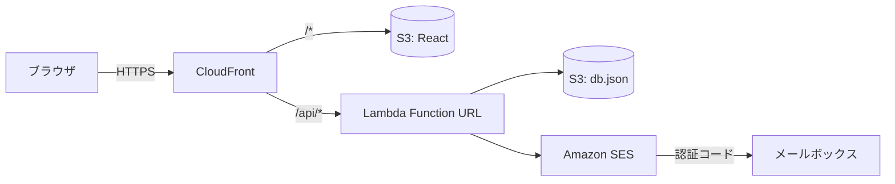
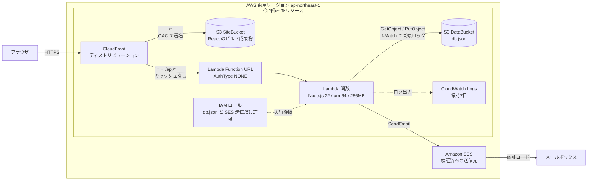
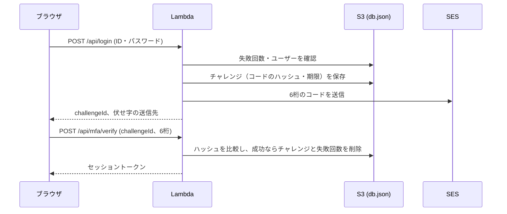

# はじめに

業務システムに多要素認証（MFA）を入れる話が出て、仕様を詰める前に一度動くものを触ってみたくなりました。

やりたいのは、ID・パスワードで認証したあとに、登録済みのメールアドレスへ6桁のコードを送って入力してもらう、よくある「メールOTP」です。Cognito や IDaaS を入れるかどうかはいったん置いて、AWS のサービスをいくつか組み合わせるだけで作りました。

使ったのは次の4つです。DB は使っていません。

- 画面: React（Vite）。S3 に置いて CloudFront で配信
- 認証処理: Lambda 1本（Function URL）
- データ: S3 上の JSON ファイル1つ
- メール送信: Amazon SES

ロックや再送の制御、ユーザー登録画面まで入れましたが、Lambda の中身は TypeScript で数百行に収まっています。

# 作ったもの

画面は4つです。

| 画面 | 内容 |
| --- | --- |
| ログイン | ログインID・パスワードを入力 |
| 認証コード入力 | メールで届いた6桁を入力する。60秒たつと再送できる |
| ログイン後 | ログインIDとセッションの有効期限を表示 |
| ユーザー登録 | ログインID・パスワード・MFAメールアドレスを登録する。登録済みユーザーの失敗回数やロック状態も見られる |

認証まわりの決めごとは次のとおりです。

| 項目 | 仕様 |
| --- | --- |
| 認証コード | 6桁の数字。有効期限10分。1回使ったら終わり |
| 1つのコードで試せる回数 | 5回。超えたら ID・パスワードからやり直し |
| 再送 | 60秒の待ち時間あり。1回のログインで5回まで。再送すると前のコードは使えなくなる |
| ロック | パスワードと認証コードの失敗が合計10回でロック |
| 失敗回数のリセット | パスワードが合っただけでは消さず、MFA まで通ったときに消す |
| 残り回数の表示 | 「あと N 回失敗するとアカウントがロックされます」と出す |
| MFAメールアドレス | 大文字・小文字の違いも含めて、全ユーザーで重複させない |

# 構成

## 通信の流れ



ブラウザがアクセスするのは CloudFront だけで、`/api/*` は Lambda の Function URL に、それ以外は S3 に振り分けています。画面と API が同じオリジンになるので、CORS の設定はしていません。

## インフラ構成図



CloudFront は `/*` を SiteBucket へ、`/api/*` を Lambda の Function URL へ流します。SiteBucket は非公開にして、OAC（Origin Access Control）経由で CloudFront からだけ読めるようにしました。Lambda は DataBucket の `db.json` を読み書きし、SES で認証コードを送ります。

| リソース | 役割 |
| --- | --- |
| CloudFront | 画面と API の入口。HTTPS もここで終端する |
| S3 SiteBucket | React のビルド成果物。CloudFront からだけ読める |
| S3 DataBucket | `db.json`（ユーザー、失敗回数、認証コードのハッシュ）。Lambda からだけ読み書きする |
| Lambda 関数・Function URL | ログイン、認証コードの検証・再送、ユーザー登録 |
| IAM ロール | `db.json` の読み書き、SES での送信（送信元アドレスを限定）、ログ出力だけを許可 |
| CloudWatch Logs | Lambda のログ。7日で消える |
| Amazon SES | 認証コードのメール送信。送信元のアドレスは事前に検証しておく |

## 費用

試すくらいの規模なら、ほとんど無料枠の中で動きます。

| サービス | 使い方 | 費用の目安 |
| --- | --- | --- |
| S3 | 画面のファイルと db.json | ほぼ0円 |
| CloudFront | 配信と HTTPS | 無料枠（月1TB）に収まる |
| Lambda | 認証処理（arm64・256MB） | 無料枠に収まる |
| SES | 認証コードのメール | 1,000通で約0.1ドル |

API Gateway や DynamoDB を使わなかったのも、費用と構成を小さくしたかったからです。

# React だけで作らなかった理由

最初は React だけで済ませられないか考えましたが、MFA ではやめました。

ブラウザで認証コードを作って比べると、開発者ツールを開けば正解が見えます。メールを送るための API キーもブラウザに置くことになりますし、パスワードの照合をブラウザでやれば照合自体を飛ばす改変もできてしまいます。

それで、秘密を扱う処理だけは Lambda に置きました。Lambda 1本ならサーバーの面倒はほとんど見なくて済みます。

# 処理の流れ



パスワードが合うと、Lambda は「チャレンジ」を1件作ります。中身は、認証コードのハッシュ、有効期限、送信回数、試行回数です。ブラウザには `challengeId` と、伏せ字にした送信先（`t***@example.com`）だけを返します。

# 実装で気をつけたところ

## S3 の JSON 1ファイルを DB 代わりにする

データは `db.json` 1つにまとめました。

```json
{
  "users": { "<loginId>": { "passwordHash": "...", "mfaEmail": "...", "updatedAt": 0 } },
  "failures": { "<loginId>": { "count": 3 } },
  "challenges": { "<challengeId>": { "loginId": "...", "codeHash": "...", "expiresAt": 0, "lastSentAt": 0, "sendCount": 1, "attempts": 0 } }
}
```

ファイル1つだと、Lambda が同時に2つ動いたときに、あとから書いたほうが先の更新を消してしまいます。失敗回数の加算が消えるとロックが効かなくなるので、S3 の条件付き書き込み（`If-Match`）で楽観ロックをかけました。

```ts
async update<T>(mutate: (db: Db) => T): Promise<T> {
  for (let attempt = 0; attempt < MAX_RETRIES; attempt++) {
    const { db, etag } = await this.load();
    const result = mutate(db);
    try {
      await this.client.send(
        new PutObjectCommand({
          Bucket: this.bucket,
          Key: this.key,
          Body: JSON.stringify(db),
          // 読んだときと ETag が同じときだけ書く。初回はファイルが無いときだけ書く
          ...(etag === undefined ? { IfNoneMatch: '*' } : { IfMatch: etag }),
        }),
      );
      return result;
    } catch (error) {
      if (isWriteConflict(error)) continue; // 412 / 409 なら読み直してやり直す
      throw error;
    }
  }
  throw new Error('db.json の更新が競合しました');
}
```

読んだあとに別の書き込みが入っていれば 412 が返るので、読み直して最初からやり直します。

## 認証コードは平文で持たない

認証コードは `challengeId` と組み合わせた HMAC にして保存し、比較は定数時間で行っています。

```ts
export function hashCode(secret: string, challengeId: string, code: string): string {
  return createHmac('sha256', secret).update(`${challengeId}:${code}`).digest('base64url');
}
```

コード自体は `crypto.randomInt` で作っていて、`Math.random` は使っていません。パスワードのハッシュには Node 標準の `scrypt` を使ったので、追加のライブラリは入れていません。

## 失敗回数は MFA まで通ったときに消す

作っていて一番迷ったのがここでした。

パスワード認証だけのシステムだと、パスワードが合った時点で失敗回数を0に戻すことが多いと思います。ただ、MFA を足したあとも同じことをすると、パスワードを知っている人は「正しいパスワードを入れて失敗回数を0に戻す、認証コードを何回か当てずっぽうで試す」を延々と繰り返せます。6桁でも、これでは総当たりされてしまいます。

なので、失敗回数はパスワードと認証コードで共通にして、MFA まで通ったときにだけ消すようにしました。

```ts
if (safeEqual(challenge.codeHash, hashCode(this.appSecret, challengeId, code))) {
  delete db.challenges[challengeId]; // コードは1回限り
  delete db.failures[loginId];       // MFA まで通ったので、ここで失敗回数を消す
  return { kind: 'success', loginId, now } as const;
}
```

## 再送は待ち時間と回数で制限する

再送ボタンを押し放題にすると、同じ人に大量のメールを送りつけるのに使えてしまいますし、SES の送信上限にも当たります。そこで、再送したら前のコードは使えなくし、次の再送まで60秒待たせ、1回のログインでは5回までにしました。

待ち時間の判定はサーバー側でやっていて、画面のカウントダウンは表示のためだけです。

## ログインIDがあるかどうかを悟らせない

「ログインIDが違います」と「パスワードが違います」を出し分けると、そのログインIDが存在するかどうかがわかってしまいます。メッセージは「ログインIDまたはパスワードが正しくありません」の1つにして、存在しないログインIDでも失敗回数を数えて同じ「残り N 回」を返しています。

応答時間の差でわかってしまわないように、存在しないログインIDのときもダミーのハッシュで scrypt を回しています。

## CloudFront から Function URL へ流すときの設定

`/api/*` を Function URL に流す振る舞いでは、オリジンリクエストポリシーを Managed-AllViewerExceptHostHeader にしています。`Host` ヘッダーまで転送すると、Function URL がリクエストを受け付けてくれません。

```yaml
- PathPattern: /api/*
  TargetOriginId: api
  # Managed-CachingDisabled
  CachePolicyId: 4135ea2d-6df8-44a3-9df3-4b5a84be39ad
  # Managed-AllViewerExceptHostHeader
  OriginRequestPolicyId: b689b0a8-53d0-40ab-baf2-68738e2966ac
```

Function URL のホスト名は、CloudFormation の中で URL から切り出しました。

```yaml
DomainName: !Select [2, !Split ['/', !GetAtt AuthFunctionUrl.FunctionUrl]]
```

認証なし（`AuthType: NONE`）の Function URL を外から呼ぶには、`lambda:InvokeFunctionUrl` に加えて、Function URL 経由に限った `lambda:InvokeFunction` の許可も必要でした。CloudFormation では `AWS::Lambda::Permission` に `InvokedViaFunctionUrl: true` を付けて追加しています。

セッショントークンは `Authorization` ヘッダーではなく、独自の `x-session-token` ヘッダーで送るようにしました。CloudFront で `Authorization` をどう転送するかを考えずに済むからです。

## デプロイは CloudFormation と AWS CLI だけ

CDK を使うにはアカウントで `cdk bootstrap` が要るので、今回は CloudFormation のテンプレートと AWS CLI だけにしました。

テンプレートには Lambda の仮のコードを `ZipFile` で書いておき、デプロイのときに esbuild で1ファイルにまとめたコードを `update-function-code` で差し替えます。これだとデプロイ用の S3 バケットも要りません。

```yaml
Code:
  ZipFile: |
    exports.handler = async () => ({ statusCode: 503, body: 'not deployed yet' });
```

# おわりに

メールOTP の MFA は、S3・CloudFront・Lambda・SES の組み合わせで思ったより小さく作れました。DB を置かなくても、S3 の条件付き書き込みを使えば JSON 1ファイルでも同時更新でデータが消えることはありません。

作ってみて改めて大事だと思ったのは、失敗回数を消すタイミングと、再送の制限の2つです。どちらも画面を触っているだけでは気づきにくいので、MFA を設計するときは最初に決めておくのがよさそうです。
